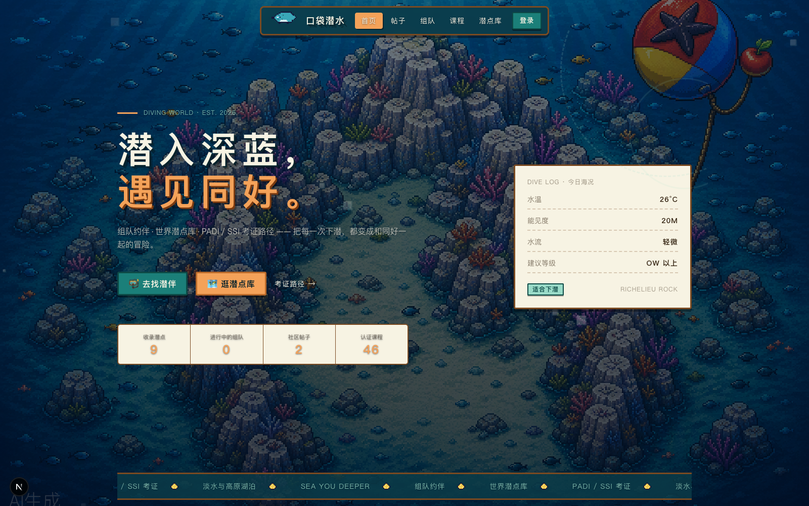
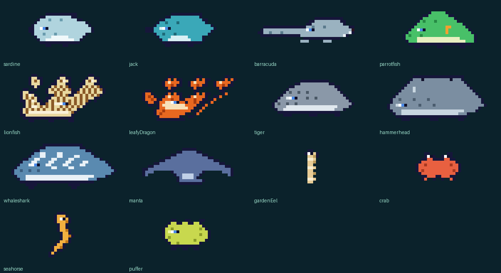
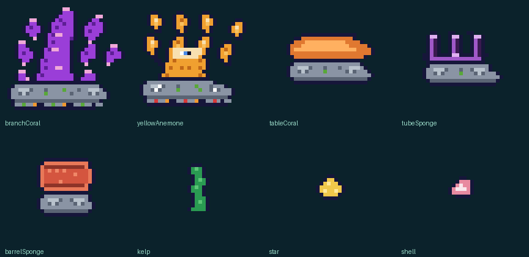
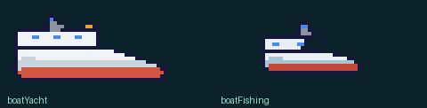
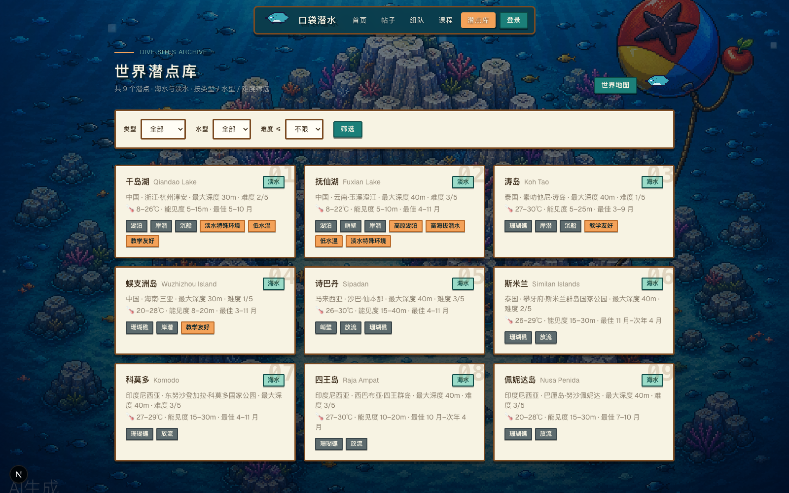

# pixel-ocean-ui · 像素海洋风 UI 规范

星露谷物语（暖木奶油）× 潜水员戴夫（深海蓝绿 Q 版生物）融合像素风的前端开发规范，
提炼自实际项目 [Diving-World](https://github.com/Noblegasesgoo/Diving-World) 的多轮实战与踩坑修复。

零图片依赖（生物 sprite 除外）、零 JS 动画依赖，SSR 友好；同时是 Kimi Code skill
（`SKILL.md`），也是可复制粘贴的组件库（`references/`）。



## 特性

- **纯 CSS box-shadow 像素画**：一个 `<span>` 画出整只鲸鲨，两次踩坑后的正确实现（内层 1px 元素 + 外层足迹占位容器）
- **24 个成品 sprite**：沙丁鱼/杰克鱼/海狼/鹦哥/狮子鱼/鬼龙/虎鲨/锤头鲨/鲸鲨/蝠鲼 + 花园鳗/螃蟹/海马/河豚 + 5 种灰岩底座珊瑚 + 海星贝壳 + 游艇渔船
- **15+ 个 `.px-*` 组件类**：奶油木框面板、按压下沉按钮、状态徽章、像素输入框、无缝跑马灯、复古立体标题……
- **背景三层结构**：cover 背景图 + 深蓝渐变遮罩 + 上升气泡，附"为什么不要用 `background-attachment: fixed`"
- **完整创作规范**：描边 / 三阶赛璐璐 / 统一三像素眼睛 / 灰岩底座，附 7 条真实踩坑清单

## 示例图

### 生物 sprite 图鉴



### 珊瑚与装饰 sprite 图鉴



### 船只 sprite



### 潜点库页面（奶油面板 + 幽灵编号卡片）



## 目录结构

```
├── SKILL.md                  # 完整规范（设计基线/实现原理/创作规范/踩坑清单）
├── README.md
├── references/
│   ├── pixel-ui.tsx          # PixelArt/SpriteArt 正确实现 + SectionHeader/Empty/StatusBadge 等组件
│   ├── globals.css           # 设计 token + 全部 .px-* 组件类 + 动画
│   └── pixel-sprites.ts      # 24 个 sprite + 共享色板（EYE/OUTLINE/ROCK_BASE）
└── assets/                   # 示例图片
```

## 接入方法

### 方式一：Next.js + Tailwind（推荐，原始技术栈）

```bash
# 1. 拷贝文件
cp references/globals.css   → 合并进 src/app/globals.css（:root token、@theme inline、.px-* 类）
cp references/pixel-ui.tsx  → src/components/pixel-ui.tsx
cp references/pixel-sprites.ts → src/components/pixel-sprites.ts

# 2. 字体（可选，Google Fonts）
# 在 globals.css 顶部加：
# @import url("https://fonts.googleapis.com/css2?family=Press+Start+2P&family=VT323&display=swap");
```

```tsx
import { SpriteArt } from "@/components/pixel-ui"

<span className="flex items-center gap-2">
  <SpriteArt name="sardine" pixel={3} />
  <span className="font-pixel font-bold">潜水世界</span>
</span>
```

### 方式二：任意 HTML 页面（单文件即用）

```html
<style>
  /* 从 references/globals.css 复制 :root、.px-panel、.px-btn、.px-badge、
     .title-retro、.px-marquee、@keyframes px-bob 等所需部分 */
</style>

<div class="px-panel" style="max-width:640px;margin:40px auto;padding:24px">
  <h1 class="title-retro font-pixel">潜入深蓝</h1>
  <button class="px-btn px-btn-teal font-pixel">去找潜伴</button>
</div>
```

### 背景三层结构

```html
<div class="px-site-bg"   style="position:fixed;inset:0;z-index:-10;pointer-events:none"></div>
<div class="px-site-mask" style="position:fixed;inset:0;z-index:-10;pointer-events:none"></div>
<main style="max-width:1200px;margin:0 auto">…</main>
```

背景图建议：像素风原图转**无损 WebP**（`PIL: lossless=True`），`<link rel="preload" as="image">` 预载。
注意背景元素本身已是 `fixed`，**不要**再加 `background-attachment: fixed`（整页截图与 iOS 会漏画一条区域）。

## 速查：两条最重要的规则

1. **box-shadow 像素画**：内层元素 = `pixel×pixel`，外层容器按图案足迹（`maxW×行数×pixel`）占位。
   box-shadow 不参与布局，缺占位层会画出界盖住文字；元素设成整图尺寸会叠成实心色块。
2. **sprite 规范**：`o` = `#16163a` 深海军蓝描边；每色基色+暗部+高光三阶；眼睛固定
   `h`（白高光）+ `i`（蓝虹膜 `#4a8ae8`）+ `e`（深瞳）；鱼一律头朝右，反向用 `scale(-1,1)`。

更多规则、组件语义、跑马灯无缝循环、踩坑清单见 [SKILL.md](SKILL.md)。

## License

项目实战提炼，自由使用。
